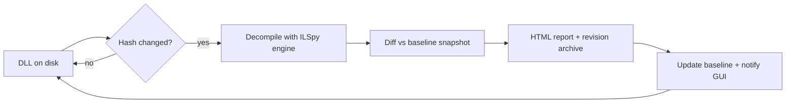

<div align="center">

# ⚙️ PatchDiff

**Watch .NET / Unity-game DLLs — get a decompiled diff every time they're patched.**

Decompiles with the ILSpy engine · snapshot baselines · automatic patch detection ·
revision archive with history, labels and a diff matrix · decompiled source browser ·
HTML diff reports · built-in updater · GUI and CLI for **Windows**.

| | |
|:--|:--|
| **Release** | `v1.1.0` |
| **Platform** | Windows x64 (WPF) |
| **Runtime** | .NET 8 — self-contained, no install needed |
| **Engine** | ILSpy (`ICSharpCode.Decompiler`) |
| **Diff** | DiffPlex, line-level side-by-side |
| **License** | WTFPL v2 |

*Licensed under the [WTFPL](#license) — do what the fuck you want to.*

</div>

---

## 📖 What is PatchDiff?

PatchDiff is a Windows tool (GUI + CLI) that keeps an eye on compiled .NET assemblies —
typically a Unity game's `Assembly-CSharp.dll` — and shows you **exactly what a patch
changed** inside them, in plain decompiled C#.

When a game updates, the old version is gone: the installer replaces the DLL and whatever
code it contained is overwritten. PatchDiff snapshots every version you've seen, so after a
patch you can ask *"what actually changed?"* and get a real answer: which types were added,
removed or modified, and a side-by-side diff of the decompiled source — without ever
touching the game files themselves.

> **TL;DR** — point it at a DLL, play the game, take the update, read the diff.

## ✨ Features

| | Feature | What it does |
|---|---|---|
| 👁 | **Watch mode** | Point PatchDiff at one or more DLLs; it detects every update automatically (`FileSystemWatcher` + polling fallback), re-decompiles, and diffs against the baseline. |
| ⚡ | **Compare mode** | One-shot diff of any two DLLs — `patchdiff compare old.dll new.dll`. |
| 🔍 | **Decompiled diffs** | Full C# decompilation via `ICSharpCode.Decompiler` (the ILSpy engine), type-by-type with line-level side-by-side highlighting (DiffPlex). |
| 🌳 | **Assembly browser** | ILSpy-style namespace → type → member tree with the decompiled source beside it; clicking a member scrolls to and highlights it; one-click *diff vs previous / current* and `.cs` export. |
| 🗄 | **Revision archive** | Every version of every watched DLL is kept: a manifest per revision (SHA-256, assembly version, timestamp, type count) plus the original DLL bytes, so you can study or restore any old build. |
| 🕘 | **History & restore** | Compare any two archived revisions, restore an old build with one click, and name revisions (e.g. *"Season 4 launch"*) so the history reads like a changelog. |
| 🔢 | **Revision matrix** | A grid of every archived revision; click a cell to compute that exact pair's diff, click again to open it. Compare any two versions, not just neighbours. |
| 📄 | **HTML reports** | Self-contained, start-collapsed diff reports for every detected patch. |
| 🔎 | **Type search** | Search every decompiled `.cs` file across all watched baselines at once. |
| 💾 | **Persistence & auto-start** | Watch list, timeline, baselines and window state survive restarts; optional *Start with Windows* so a rebooted PC keeps watching. |
| 📥 | **Built-in updater** | Help ▸ *Check for updates* follows the GitHub Releases feed — download, stage and apply on exit, with your data untouched. |
| 🔔 | **System tray** | Close-to-tray, tray menu and balloon alerts on detected patches; single-instance; drag & drop DLLs or folders. |

<details>
<summary><b>🧠 Why snapshot baselines instead of diffing on demand?</b></summary>

A game update replaces the DLL *in place* — the old bytes are gone the moment the
installer runs. PatchDiff keeps a decompiled snapshot of every version it has seen, so:

- you can diff against **any** past revision, not just the previous one
- the revision matrix lets you compare any two versions you've ever archived
- if you weren't running PatchDiff during an update, the next launch still archives
  the new version and keeps the old baseline intact
- `restore` can put an old build back on disk

</details>

## 🚀 Install on Windows

### Option A — download a release (easiest)

Grab a build from the [Releases](../../releases) page — every `v*` tag ships prebuilt binaries:

| Artifact | What it is |
|---|---|
| `PatchDiff-app-win-x64.zip` | **Desktop app** — the GUI, self-contained single exe |
| `patchdiff-win-x64.zip` | **CLI** — self-contained single exe |

1. Download and extract the zip.
2. Run `PatchDiff.exe` (GUI) — no installer needed. Everything lives in
   `%LOCALAPPDATA%\PatchDiff`.
3. For the CLI, put `patchdiff.exe` somewhere on your `PATH`, or just run it from its folder.

Both are self-contained: **no .NET runtime install required**.

### Option B — build from source

Requires [git](https://git-scm.com) and the [.NET 8 SDK](https://dotnet.microsoft.com/download/dotnet/8.0).

```bat
git clone https://github.com/Tester12-SR-24/PatchDiff.git
cd PatchDiff
git checkout main
dotnet build
```

That builds the whole solution — Core library, CLI and WPF app:

```bat
:: run the CLI
dotnet run --project src\PatchDiff.Cli -- compare a.dll b.dll

:: run the GUI
start src\PatchDiff.App\bin\Debug\net8.0-windows\PatchDiff.exe
```

<details>
<summary><b>📦 Self-contained single-file builds (what the releases contain)</b></summary>

```bat
:: CLI — runs on any x64 Windows machine, no .NET install required
dotnet publish src\PatchDiff.Cli -c Release -r win-x64 --self-contained true ^
  /p:PublishSingleFile=true /p:IncludeNativeLibrariesForSelfExtract=true ^
  -o publish\cli

:: GUI app
dotnet publish src\PatchDiff.App -c Release -r win-x64 --self-contained true ^
  /p:PublishSingleFile=true /p:IncludeNativeLibrariesForSelfExtract=true ^
  -o publish\app
```

Zip `publish\cli` as `patchdiff-win-x64.zip` and `publish\app` as
`PatchDiff-app-win-x64.zip` to reproduce the release assets.

</details>

## 🖥 Usage

### GUI

Run `PatchDiff.exe`. On first launch you get a short welcome screen with three actions:

- **Watch a real DLL…** — pick e.g. `<game>_Data\Managed\Assembly-CSharp.dll`
- **Watch a whole folder…** — pick any DLL inside `…_Data\Managed` to watch them all
- **Compare two DLLs…** — one-shot diff without watching anything

The window is split into three areas:

- **Left rail** — a search box over every decompiled `.cs` file, your watched assemblies with
  live status pills (`UP TO DATE` / `ANALYZING…` / `NEW BASELINE` / `UPDATED` / `MISSING`),
  a grid of actions for the selected assembly (Browse, Diff, History, Sources, Report,
  Re-check, Remove), and a timeline of detected patches.
- **Center tabs** — Overview plus one tab per view you open: **Browse** (decompiled source
  browser), **Diff** (side-by-side coloured diff), **History** (revisions, labels, matrix,
  restore).
- **Status bar** — watched count, timeline events, and where your data lives.

Closing the window keeps PatchDiff running in the tray, so it keeps watching. Use the tray
menu (or **File ▸ Exit**) to quit properly.

### CLI

```text
┌────────────────────────────────────────────────────────────────────────────┐
│  C:\> patchdiff compare old\Assembly-CSharp.dll new\Assembly-CSharp.dll    │
│                                                                            │
│  PatchDiff — decompiled diff                                               │
│  Sample.dll: 2 types added, 0 removed, 5 modified                            │
│  Report: C:\Users\you\AppData\Local\PatchDiff\Reports\demo.html            │
└────────────────────────────────────────────────────────────────────────────┘
```

```bat
:: one-shot: compare two versions of a DLL
patchdiff compare old\Assembly-CSharp.dll new\Assembly-CSharp.dll -o diff.html

:: monitor a Unity game — writes baseline, then auto-diffs on every patch
patchdiff watch "C:\Games\MyGame_Data\Managed\Assembly-CSharp.dll"

:: watch several DLLs with a custom poll interval
patchdiff watch --poll 5 Assembly-CSharp.dll MyGame.Network.dll

:: list every archived revision of a watched DLL (SHA, version, timestamp, types)
patchdiff history "C:\Games\MyGame_Data\Managed\Assembly-CSharp.dll"

patchdiff version
```

`watch` runs until Ctrl+C. On each detected update it prints `+added / −removed / ~modified`
type counts and writes a self-contained HTML report.

## ⚙️ How it works



1. **Baseline** — the first scan decompiles every top-level type of the DLL to C# (via
   `ICSharpCode.Decompiler`) and stores the snapshot in
   `%LOCALAPPDATA%\PatchDiff\Snapshots`. The revision archive
   (`%LOCALAPPDATA%\PatchDiff\Revisions` + `Archive`) keeps the manifest and the DLL bytes for
   every version seen from then on.
2. **Detection** — `FileSystemWatcher` (rename/change, debounced) plus a polling fallback
   (default every 10 s) hash the DLL; read-retries tolerate files still being copied, which is
   exactly how Unity replaces `Assembly-CSharp.dll` on a patch.
3. **Diff** — changed hash ⇒ re-decompile ⇒ type-by-type **added / removed / modified** diff
   against the baseline (DiffPlex line-level side-by-side).
4. **Report & archive** — an HTML report is written to `%LOCALAPPDATA%\PatchDiff\Reports`, the
   revision is archived, the baseline is updated, and the GUI timeline/log are notified.

<details>
<summary><b>🔎 Data layout</b></summary>

```text
%LOCALAPPDATA%\PatchDiff
├── Snapshots            decompiled baseline per watched DLL
├── Reports              self-contained HTML diff reports
├── Revisions            manifest per revision (SHA, version, timestamp, types)
├── Archive              original DLL bytes per revision
├── Logs                 crash + updater logs
└── SettingsFile.json    settings (poll interval, start-minimized, retention…)
```

Set the `PATCHDIFF_DATA_DIR` environment variable to redirect the entire data root anywhere
else — useful for portable installs or running isolated instances side by side.

</details>

## 📝 Technical notes

- Works with **Mono-scripted** Unity games (managed `Assembly-CSharp.dll` and friends in
  `<game>_Data\Managed`). IL2CPP builds compile to native code — nothing to decompile.
- References resolve from the DLL's own folder first (Unity's Managed folder ships its own
  BCL), falling back to the .NET Framework 4.x directories.
- Only top-level types are tracked individually; nested types ride along in their parent.
- Built for Windows (WPF, x64). There are no Linux or macOS builds.

## 🔥 Power hacks

Things the tool does that aren't obvious from the UI:

- **Diff a DLL you don't have a baseline for** — `patchdiff compare` doesn't need PatchDiff
  to have ever watched the file. Point it at any two DLLs (even from different games) and it
  decompiles both on the fly.
- **Use the revision archive as a game-patch changelog** — every time a game updates,
  PatchDiff archives the old DLL. After a few patches you have a local history of every
  version you've played, with decompiled source you can grep through without launching the
  game.
- **Isolate two games side by side** — set `PATCHDIFF_DATA_DIR` to a different folder in each
  terminal, run two instances, and watch two different games at the same time without
  cross-contaminating baselines.
- **Feed the HTML report into anything** — the report is a single self-contained `.html`
  file with no external dependencies. Open it in a browser, email it, drop it in a Discord
  channel, or script against it.
- **Restore a previous build to A/B test** — History ▸ Restore puts the old DLL bytes back
  on disk. If a patch broke something, you can roll back and check without reinstalling.
- **Grep the decompiled sources** — Sources ▸ Export writes every decompiled type as a
  separate `.cs` file. That's a full-text-searchable codebase of whatever the game ships.

## 🤝 Contributing

There are no contribution guidelines. There is no code of conduct. There is no CLA.

This is WTFPL. **Do what the fuck you want to.**

If you want to contribute:
- Fork it, change it, open a PR. If it's good, it gets merged. If it's not, nobody cares.
- Report bugs. Be specific. Screenshots help.
- Don't ask permission. The license literally says you don't need it.

## 🧰 Building blocks

- [ICSharpCode.Decompiler](https://github.com/icsharpcode/ILSpy) — C# decompilation engine
- [DiffPlex](https://github.com/mmanela/diffplex) — line-level diffing
- WPF (.NET 8) for the desktop app, hand-rolled CLI argument parsing

## 📄 License

PatchDiff is released under the **WTFPL Version 2** — see [LICENSE](LICENSE).

> *DO WHAT THE FUCK YOU WANT TO PUBLIC LICENSE*
> Copyright © 2004 Sam Hocevar
>
> **0.** You just DO WHAT THE FUCK YOU WANT TO.
