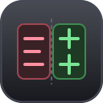

<div align="center">



# PatchDiff

**Watch .NET / Unity-game DLLs — get a decompiled diff every time they're patched.**

Decompiles with the ILSpy engine · snapshot baselines · automatic patch detection · HTML diff reports · GUI and CLI.

</div>

---

## Install (GitHub Releases)

Grab a build from the [Releases](../../releases) page — every `v*` tag ships prebuilt binaries:

| Artifact | What it is |
|---|---|
| `patchdiff-win-x64.zip` | CLI for Windows (single exe, self-contained) |
| `patchdiff-linux-x64.tar.gz` | CLI for Linux |
| `patchdiff-osx-arm64.tar.gz` | CLI for Apple Silicon |
| `PatchDiff-app-win-x64.zip` | WPF desktop app (Windows) |

Extract, put `patchdiff(.exe)` somewhere on your `PATH`, done.

## CLI

```bash
# one-shot: compare two versions of a DLL
patchdiff compare old/Assembly-CSharp.dll new/Assembly-CSharp.dll -o diff.html

# monitor a Unity game — writes baseline, then auto-diffs on every patch
patchdiff watch "C:\Games\MyGame_Data\Managed\Assembly-CSharp.dll"

# watch several DLLs, with a custom poll interval
patchdiff watch --poll 5 Assembly-CSharp.dll MyGame.Network.dll
```

`watch` runs until Ctrl+C. On each detected update it prints `+added / −removed / ~modified`
type counts to the console and writes a self-contained HTML report.

## GUI

The desktop app shows the same data as a **patch feed**: a card per watched DLL
(`UP TO DATE` / `ANALYZING…` / `NEW BASELINE` / `UPDATED`), a timeline of detected
updates, an activity log, and a side-by-side colored diff viewer
(*Open diff*) with one-click HTML reports.

### Persistence & auto-refresh (ILSpy-style)

- Watch list, timeline history, last diffs, and window position survive closing the app
  or a full PC restart.
- On the next launch PatchDiff re-checks every watched DLL against its stored baseline —
  cheap hash comparison first; decompile + diff only if the file changed while it was away.
- **File ▸ Start with Windows** arms PatchDiff at logon, so a rebooted PC is watching again
  before you even open the app.

### ILSpy-inspired extras

- **🔍 Search types** (toolbar) — search over every decompiled type in all watched baselines
  at once, with an IDE-style results popup; Enter opens the decompiled source.
- **⤓ Sources** (per card) — export the whole decompiled snapshot to a folder of `.cs` files
  (the light version of ILSpy's *Save Project*), e.g. to feed into git or another diff tool.
- **🔄 All (F5)** — reload/re-check every watched DLL on demand.
- **Help ▸ Check for updates** — queries this repo's latest release and offers the download
  when it's newer than your build.

## How it works

1. **Baseline** — the first scan decompiles every top-level type of the DLL to C#
   (via `ICSharpCode.Decompiler`, the same engine as ILSpy) and stores the snapshot
   in `%LOCALAPPDATA%\PatchDiff\Snapshots`.
2. **Detection** — `FileSystemWatcher` (rename/change, debounced) plus a polling
   fallback hash the DLL; read-retries tolerate files still being copied, which is
   exactly how Unity replaces `Assembly-CSharp.dll` on a patch.
3. **Diff** — changed hash ⇒ re-decompile ⇒ type-by-type **added / removed / modified**
   diff against the baseline (DiffPlex line-level side-by-side).
4. **Report** — HTML report written to `%LOCALAPPDATA%\PatchDiff\Reports`, baseline updated, event emitted.

## Build from source

```bash
dotnet build                      # PatchDiff.sln: Core + CLI + WPF app
dotnet run --project src/PatchDiff.Cli -- compare a.dll b.dll
```

Requires the .NET 8 SDK.

## Notes

- Works with **Mono-scripted** Unity games (managed `Assembly-CSharp.dll` and friends in
  `<game>_Data/Managed`). IL2CPP builds compile to native code — nothing to decompile.
- References resolve from the DLL's own folder first (Unity's Managed folder ships its
  own BCL), falling back to the .NET Framework 4.x directories.
- Only top-level types are tracked individually; nested types ride along in their parent.
