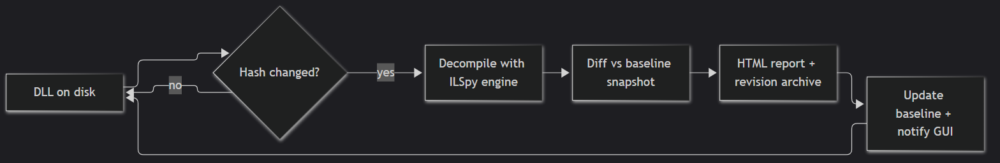

<div align="center">

# ⚙️ PatchDiff

**Watch .NET / Unity-game DLLs — get a decompiled diff every time they're patched.**

Decompiles with the ILSpy engine · snapshot baselines · automatic patch detection ·
revision archive with history · decompiled source browser · HTML diff reports ·
built-in updater · Diff Workbench GUI and CLI for **Windows and Linux**.

| | |
|:--|:--|
| **Platform** | Windows · Linux x64/ARM64 (Avalonia) |
| **Runtime** | .NET 8 — self-contained, no install needed |
| **Engine** | ILSpy (`ICSharpCode.Decompiler`) |
| **Diff** | DiffPlex, line-level side-by-side |
| **License** | WTFPL v2 |

</div>

---

## 🤖 Disclosure

This project is vibe-coded using **6 AI models simultaneously**:
**Chimp**, **Alvin**, **Gal**, **Farway**, **GLM-TDC**, and **Arbitration**.

Each one ran in its own lane — implementation, assets and docs, QA and audit, review,
and arbitration — and they coordinated through a shared message hub rather than a
single chat. Every line of code, every icon, and every release note in this repository
was produced by one of them.

This is a Do Whatever The Fuck project — you are free to tear everything down and rebuild it.

## 📖 What is PatchDiff?

PatchDiff is a cross-platform desktop and CLI tool that keeps an eye on compiled .NET assemblies —
typically a Unity game's `Assembly-CSharp.dll` — and shows you **exactly what a patch
changed** inside them, in plain decompiled C#.

When a game updates, the old version is gone: the installer replaces the DLL and whatever
code it contained is overwritten. PatchDiff snapshots every version you've seen, so after a
patch you can ask *"what actually changed?"* and get a real answer: which types were added,
removed or modified, and a side-by-side diff of the decompiled source — without ever
touching the game files themselves.

> **TL;DR** — point it at a DLL, play the game, take the update, read the diff.

## ✨ Features

| | Feature | What it does |
|---|---|---|
| 👁 | **Watch mode** | Point PatchDiff at one or more DLLs; it detects every update automatically (`FileSystemWatcher` + polling fallback), re-decompiles, and diffs against the baseline. |
| ⚡ | **Compare mode** | One-shot diff of any two DLLs — `patchdiff compare old.dll new.dll`, or **Compare versions** / **Compare DLLs** in the GUI. |
| 🔍 | **Decompiled diffs** | Full C# decompilation via `ICSharpCode.Decompiler` (the ILSpy engine). Collapsible per-type sections with line-delta badges (`+n` green / `−n` red / `~n` yellow), **Expand all / Collapse all**, per-type filter, refined side-by-side rows with line numbers, 3px left-edge accents, tinted text and ellipsised long lines. One shared vertical scrollbar moves both versions together; each side keeps its own horizontal scrollbar. |
| 🌳 | **Assembly browser** | ILSpy-style namespace → type → member tree with the decompiled source beside it; clicking a member scrolls to and highlights it; one-click *diff vs previous / current* and `.cs` export. |
| 🗄 | **Revision archive** | Every version of every watched DLL is kept: a manifest per revision (SHA-256, assembly version, timestamp, type count) plus the original DLL bytes, so you can study or restore any old build. |
| 🕘 | **History & restore** | Compare any revision against the previous one or the current baseline, and save an old build back to disk with one click. |
| 📄 | **HTML reports** | Self-contained, start-collapsed diff reports for every detected patch. |
| 💾 | **Persistence** | Watch list, timeline, baselines and window state survive restarts; optional *Start with Windows* (Windows) so a rebooted PC keeps watching. |
| 📥 | **Built-in updater** | The nav rail shows *Check for updates*, which highlights when a newer release is found. Clicking it downloads the release installer and runs it automatically — the Windows setup exe, or the Linux `install.sh` from the tarball — then restarts PatchDiff. |
| 🔒 | **Local first** | Everything — DLLs, baselines, reports, settings — stays on your device. Nothing is uploaded, nothing phones home beyond the update check. |

<details>
<summary><b>🧠 Why snapshot baselines instead of diffing on demand?</b></summary>

A game update replaces the DLL *in place* — the old bytes are gone the moment the
installer runs. PatchDiff keeps a decompiled snapshot of every version it has seen, so:

- you can diff against **any** past revision, not just the previous one
- if you weren't running PatchDiff during an update, the next launch still archives
  the new version and keeps the old baseline intact
- `restore` can put an old build back on disk

</details>

## 🖥 The Diff Workbench

The desktop app is a three-pane workbench, built for the watch → patch → diff loop:

- **Left rail — navigation & watching.** Overview, *Compare versions* and *Reports*
  live at the top; below them your watched assemblies with live status pills
  (`UP TO DATE` / `ANALYZING…` / `NEW BASELINE` / `UPDATED` / `MISSING`), plus
  *Add a folder* and *Settings*. A filter box narrows the list as it grows.
- **Center — the workspace.** Closable tabs for everything you open: **Diff**
  (side-by-side decompiled diff), **Browse** (decompiled source browser), **History**
  (revision archive). A toolbar row offers *Recheck all* and *Browse*; an activity log
  streams every detection, decompile and report at the bottom.
- **Right — the inspector.** Details for the selected assembly (name, version, path)
  with one-click actions — *Open latest diff*, *Browse decompiled code*,
  *Revision history*, *Recheck*, *Remove* — and a *Recent activity* timeline.
- **Everywhere.** Dark slate theme with cyan/violet accents, a header that puts
  *Compare DLLs* and *＋ Add DLL* one click away, and a footer that tells you where
  your data lives.

First run: hit **＋ Add DLL**, pick e.g. `<game>_Data\Managed\Assembly-CSharp.dll`,
and PatchDiff captures the baseline. From then on it watches silently — every patch
lands in the timeline, the diff tabs and the reports folder.

## ⌨️ CLI

```text
┌────────────────────────────────────────────────────────────────────────────┐
│  C:\> patchdiff compare old\Assembly-CSharp.dll new\Assembly-CSharp.dll    │
│                                                                            │
│  PatchDiff — decompiled diff                                               │
│  Sample.dll: 2 types added, 0 removed, 5 modified                          │
│  Report: C:\Users\you\AppData\Local\PatchDiff\Reports\demo.html            │
└────────────────────────────────────────────────────────────────────────────┘
```

```bat
:: one-shot: compare two versions of a DLL
patchdiff compare old\Assembly-CSharp.dll new\Assembly-CSharp.dll -o diff.html

:: monitor a Unity game — writes baseline, then auto-diffs on every patch
patchdiff watch "C:\Games\MyGame_Data\Managed\Assembly-CSharp.dll"

:: watch several DLLs with a custom poll interval
patchdiff watch --poll 5 Assembly-CSharp.dll MyGame.Network.dll

:: list every archived revision of a watched DLL (SHA, version, timestamp, types)
patchdiff history "C:\Games\MyGame_Data\Managed\Assembly-CSharp.dll"

patchdiff version
```

`watch` runs until Ctrl+C. On each detected update it prints `+added / −removed / ~modified`
type counts and writes a self-contained HTML report.

## ⚙️ How it works



1. **Baseline** — the first scan decompiles every top-level type of the DLL to C# (via
   `ICSharpCode.Decompiler`) and stores the snapshot in
   `%LOCALAPPDATA%\PatchDiff\Snapshots`. The revision archive
   (`%LOCALAPPDATA%\PatchDiff\Revisions` + `Archive`) keeps the manifest and the DLL bytes for
   every version seen from then on.
2. **Detection** — `FileSystemWatcher` (rename/change, debounced) plus a polling fallback
   (default every 10 s) hash the DLL; read-retries tolerate files still being copied, which is
   exactly how Unity replaces `Assembly-CSharp.dll` on a patch.
3. **Diff** — changed hash ⇒ re-decompile ⇒ type-by-type **added / removed / modified** diff
   against the baseline (DiffPlex line-level side-by-side).
4. **Report & archive** — an HTML report is written to `%LOCALAPPDATA%\PatchDiff\Reports`, the
   revision is archived, the baseline is updated, and the GUI timeline/log are notified.

Every check saves the analyzed version as the new baseline, so each diff shows exactly
one patch's changes — not a cumulative diff since the first version ever seen. Older
changes live in History, where they can be diffed against the current baseline at any time.

## 🚀 Install

Download the package for your operating system: Windows and Linux x64/ARM64 builds are available.

### Windows

| Artifact | What it is |
|---|---|
| `PatchDiff-setup-x.y.z.exe` | **Installer** — installs to `C:\Program Files\PatchDiff` by default, with a directory page so you can pick any folder; optional desktop shortcut, Start-menu entry, uninstaller |
| `PatchDiff-app-win-x64.zip` | **Portable desktop app** — extract anywhere user-writable and run `PatchDiff.exe` |
| `patchdiff-win-x64.zip` | **CLI** — extract and put `patchdiff.exe` on your `PATH` |

All are self-contained: **no .NET runtime install required**.

### Linux

Choose the package matching your CPU architecture:

| Package | Architecture | How to run |
|---|---|---|
| `PatchDiff-linux-x64.AppImage` | x86-64 / AMD64 | `chmod +x PatchDiff-linux-x64.AppImage && ./PatchDiff-linux-x64.AppImage` |
| `PatchDiff-linux-arm64.AppImage` | ARM64 / AArch64 | `chmod +x PatchDiff-linux-arm64.AppImage && ./PatchDiff-linux-arm64.AppImage` |
| `PatchDiff-linux-x64.tar.gz` | x86-64 / AMD64 | Extract, then `./install.sh` (or run `./PatchDiff`) |
| `PatchDiff-linux-arm64.tar.gz` | ARM64 / AArch64 | Extract, then `./install.sh` (or run `./PatchDiff`) |

#### AppImage

Download the AppImage for your architecture, then:

```bash
chmod +x PatchDiff-linux-x64.AppImage
./PatchDiff-linux-x64.AppImage
```

For ARM64, use `PatchDiff-linux-arm64.AppImage` instead. AppImages are self-contained and do not require a .NET runtime. If your distribution does not support AppImage out of the box, install FUSE 2 (Ubuntu/Debian: `sudo apt install libfuse2`).

#### Tarball

Extract the matching `PatchDiff-linux-x64.tar.gz` or `PatchDiff-linux-arm64.tar.gz`, then run the installer. It copies the app into a folder you choose, adds a `patchdiff` launcher to your `PATH`, and registers a desktop entry and icon:

```bash
tar -xzf PatchDiff-linux-x64.tar.gz -C ~/Applications/PatchDiff
cd ~/Applications/PatchDiff
./install.sh                          # default location
./install.sh --dir /opt/patchdiff     # or pick a folder
./install.sh --uninstall              # remove it again
```

The default install folder is `/opt/patchdiff` when run as root and `~/.local/share/patchdiff` otherwise. The archive also contains the GUI (`PatchDiff`) and CLI (`patchdiff-cli`) if you would rather run them in place:

```bash
chmod +x PatchDiff patchdiff-cli
./PatchDiff                 # GUI
./patchdiff-cli version     # CLI
```

The GUI uses Avalonia and supports X11/Wayland. The self-contained binaries need no .NET runtime. On Debian/Ubuntu, install these shared libraries if they are not already present:

```bash
sudo apt install libx11-6 libice6 libsm6 libfontconfig1
```

### Build from source

Requires [git](https://git-scm.com) and the [.NET 8 SDK](https://dotnet.microsoft.com/download/dotnet/8.0). The desktop app is Avalonia-based (`src/PatchDiff.AppA`) and the instructions below work on Windows and Linux alike.

```bash
git clone https://github.com/Tester12-SR-24/PatchDiff.git
cd PatchDiff
git checkout main
dotnet build
```

This builds the solution — Core library, CLI and desktop app:

```bash
# run the CLI
dotnet run --project src/PatchDiff.Cli -- compare a.dll b.dll

# run the GUI
dotnet run --project src/PatchDiff.AppA
```

<details>
<summary><b>📦 Self-contained single-file builds</b></summary>

```bash
# CLI — runs on any x64 machine, no .NET install required
dotnet publish src/PatchDiff.Cli -c Release -r win-x64 --self-contained true \
  /p:PublishSingleFile=true /p:IncludeNativeLibrariesForSelfExtract=true \
  -o publish/cli

# GUI app (use linux-x64 / linux-arm64 for Linux)
dotnet publish src/PatchDiff.AppA -c Release -r win-x64 --self-contained true \
  /p:PublishSingleFile=true /p:IncludeNativeLibrariesForSelfExtract=true \
  -o publish/app
```

Zip `publish/cli` as `patchdiff-win-x64.zip` and `publish/app` as
`PatchDiff-app-win-x64.zip` to create the Windows distributable package.

</details>

## 🗃 Data & privacy

PatchDiff is local-first: your game DLLs, baselines and reports never leave the machine.

```text
%LOCALAPPDATA%\PatchDiff
├── Snapshots            decompiled baseline per watched DLL
├── Reports              self-contained HTML diff reports
├── Revisions            manifest per revision (SHA, version, timestamp, types)
├── Archive              original DLL bytes per revision
├── Logs                 crash + updater logs
└── SettingsFile.json    settings (poll interval, revision retention…)
```

Set the `PATCHDIFF_DATA_DIR` environment variable to redirect the entire data root anywhere
else — useful for portable installs or running isolated instances side by side.

## 📝 Technical notes

- Works with **Mono-scripted** Unity games (managed `Assembly-CSharp.dll` and friends in
  `<game>_Data\Managed`). IL2CPP builds compile to native code — nothing to decompile.
- References resolve from the DLL's own folder first (Unity's Managed folder ships its own
  BCL), falling back to the .NET Framework 4.x directories.
- Only top-level types are tracked individually; nested types ride along in their parent.
- The desktop app uses Avalonia on Windows and Linux. Linux packages are available for x64
  and ARM64. There are no macOS builds.
- A stale watch pointing into a removed folder never blocks startup — the watcher is dropped
  with a log line and polling takes over until the file returns.

## 🔥 Power hacks

Things the tool does that aren't obvious from the UI:

- **Diff a DLL you don't have a baseline for** — `patchdiff compare` doesn't need PatchDiff
  to have ever watched the file. Point it at any two DLLs (even from different games) and it
  decompiles both on the fly.
- **Use the revision archive as a game-patch changelog** — every time a game updates,
  PatchDiff archives the old DLL. After a few patches you have a local history of every
  version you've played, with decompiled source you can grep through without launching the
  game.
- **Isolate two games side by side** — set `PATCHDIFF_DATA_DIR` to a different folder in each
  terminal, run two instances, and watch two different games at the same time without
  cross-contaminating baselines.
- **Feed the HTML report into anything** — the report is a single self-contained `.html`
  file with no external dependencies. Open it in a browser, email it, drop it in a Discord
  channel, or script against it.
- **Restore a previous build to A/B test** — History lets you save any archived revision's
  DLL bytes back to disk. If a patch broke something, you can roll back and check without
  reinstalling.
- **Grep the decompiled sources** — Browse ▸ export writes any decompiled type as a `.cs`
  file; export the types you care about and you have a full-text-searchable codebase of
  whatever the game ships.

## 🧰 Building blocks

- [ICSharpCode.Decompiler](https://github.com/icsharpcode/ILSpy) — C# decompilation engine
- [DiffPlex](https://github.com/mmanela/diffplex) — line-level diffing
- Avalonia (.NET 8) for the desktop app, hand-rolled CLI argument parsing

## ⚖️ License

[WTFPL v2](https://en.wikipedia.org/wiki/WTFPL) — Do What the Fuck You Want to Public License.
See [LICENSE](LICENSE).
